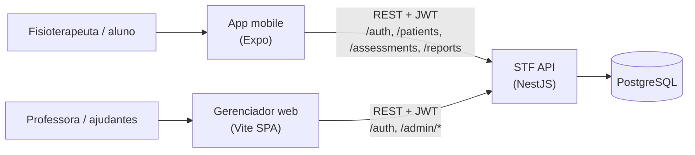

# STF Gerenciador Web

Painel web de supervisão do **Sênior Teste Funcional (STF)**. É por aqui que a **professora** (conta `ADMIN`) e seus **ajudantes** (`ASSISTANT`) acompanham os fisioterapeutas — alunos de fisioterapia da clínica-escola —, os pacientes idosos que eles avaliam e os relatórios clínicos gerados pelo sistema.

---

## O ecossistema STF — três sistemas, uma API

O STF é dividido em três repositórios, clonados lado a lado na mesma pasta:

```
myProjects/
├── stf-api/                 → API + banco de dados (o "cérebro")
├── senior-test-funcional/   → App mobile do fisioterapeuta + especificação do produto
└── stf-gerenciador-web/     → Painel web da professora (este repositório)
```

| Sistema | Quem usa | O que faz | Tecnologia |
|---------|----------|-----------|------------|
| **[STF API](https://github.com/Alancfops/senior-test-api)** (`senior-test-api`, pasta `stf-api`) | Ninguém diretamente — atende os dois clientes | Guarda contas, pacientes e avaliações; calcula pontuações e classificações dos instrumentos clínicos; gera os PDFs; controla permissões, auditoria e e-mails | NestJS · Prisma · PostgreSQL |
| **[App mobile](https://github.com/Alancfops/senior-test-funcional)** (`senior-test-funcional`) | Fisioterapeutas (alunos) | Cadastra pacientes, aplica os testes funcionais (TUG, Katz, Berg, Tinetti, MEEM) passo a passo, mostra histórico, gráfico de evolução e PDF de cada avaliação | Expo · React Native |
| **Gerenciador web** (este repo) | Professora e ajudantes | Visão de toda a equipe: lista alunos e pacientes, transfere/exclui registros, aprova ajudantes, baixa relatórios (individuais e geral) e consulta a trilha de auditoria | Vite · React · TypeScript |



**Princípio central:** a API é a única fonte da verdade. Nenhum dos clientes calcula pontuação, interpreta resultado clínico ou monta PDF — eles só exibem o que a API devolve. Por isso uma correção de regra clínica vale para o app e para o painel ao mesmo tempo.

### Papéis

| Papel | Onde entra | Pode fazer |
|-------|-----------|-----------|
| `THERAPIST` (aluno) | App mobile | Vê e avalia **apenas os próprios** pacientes |
| `ASSISTANT` (ajudante) | App + gerenciador | No painel: supervisiona alunos e pacientes como a professora, mas não gerencia ajudantes (aprovar, recusar, revogar) |
| `ADMIN` (professora) | App + gerenciador | Visão transversal de toda a equipe; conta única, criada só pelo script `admin:set` da API |

Um ajudante é um aluno que pediu acesso ao painel e foi aprovado pela professora — é a mesma conta do app, promovida.

---

## O que o gerenciador oferece

| Tela | Rota | Para quê |
|------|------|---------|
| Login, troca de senha, recuperação | `/login`, `/change-password`, `/forgot-password/*` | Acesso só para `ADMIN`/`ASSISTANT`; troca obrigatória da senha temporária no 1º login |
| Início | `/dashboard` | Totais da equipe (fisioterapeutas, pacientes, avaliações) |
| Fisioterapeutas | `/therapists`, `/therapists/:id` | Lista e detalhe de cada aluno, com seus pacientes; exclusão de conta |
| Pacientes | `/patients`, `/patients/:id` | Perfil, histórico de avaliações, gráfico de evolução; transferir ou excluir paciente |
| Detalhe da avaliação | `/patients/:id/assessment/:assessmentId` | Resultado e classificação; download do PDF |
| Solicitações de acesso / Ajudantes | `/access-requests`, `/assistants` | Aprovar, recusar ou revogar ajudantes |
| Auditoria | `/audit-logs` | Quem excluiu, transferiu, aprovou ou baixou relatório, e quando |
| Relatórios PDF | `/reports` | PDF por avaliação e **relatório geral** por período (até 184 dias) |
| Dúvidas sobre testes / Informações do sistema | `/testes/duvidas`, `/system-info` | Material de apoio sobre os instrumentos e o sistema |

Toda exclusão ou transferência pede confirmação explícita e fica registrada na auditoria da API.

---

## Como rodar localmente

**Pré-requisitos:** Node.js 20+, Docker (para o PostgreSQL da API) e `make`. Os três repositórios devem estar lado a lado.

```bash
# 1) API (primeira vez)
cd ../stf-api
make setup && make migrate
npm run admin:set -- --email professora@exemplo.com --name "Profa. Fulana"   # cria a conta ADMIN

# 2) Gerenciador
cd ../stf-gerenciador-web
make setup      # npm install + .env
make start      # sobe a API (:3000) e o gerenciador (:5173) juntos
```

Abra <http://localhost:5173> e entre com o e-mail da professora e a senha temporária (enviada por e-mail ou exibida no terminal pelo `admin:set`).

Se a API já estiver rodando em outro terminal, use só `make start-web`.

### Configuração

| Onde | Variável | Valor em dev |
|------|----------|--------------|
| `stf-gerenciador-web/.env` | `VITE_STF_API_URL` | `http://localhost:3000` (sem barra final) |
| `stf-api/.env` | `CORS_ORIGINS` | `http://localhost:5173` |

Em produção, `VITE_STF_API_URL` deve usar **HTTPS** e `CORS_ORIGINS` deve listar só o domínio real do painel.

### Comandos

| Comando | O que faz |
|---------|-----------|
| `make start` / `make start-web` | API + painel / só o painel (Vite, `:5173`) |
| `npm run lint` | ESLint |
| `npm run typecheck` | TypeScript sem emitir arquivos |
| `npm run test` | Testes unitários (Vitest + Testing Library) |
| `npm run build` | Build de produção em `dist/` (estático — qualquer servidor web serve) |
| `npm run generate:api-types` | Regenera tipos a partir do Swagger da API rodando |

---

## Arquitetura do painel

```
src/
├── pages/       → telas (composição fina)
├── features/    → hooks TanStack Query e regras de tela por domínio
├── components/  → UI reutilizável, sem acesso direto à API
├── lib/api/     → cliente HTTP tipado
├── lib/auth/    → sessão (sessionStorage) e guarda de papel
└── types/       → tipos da API
```

- **Sessão:** o JWT fica em `sessionStorage` (sobrevive ao F5, some ao fechar a aba); sair limpa o token e o cache de dados.
- **LGPD:** nenhum token, senha ou dado clínico vai para logs; PDFs são baixados como arquivo temporário, sem ficar guardados no navegador; mensagens de erro são genéricas.
- **Visual:** paleta oficial do STF via variáveis `--stf-*`, adaptada para densidade de painel (tabelas, sidebar).

---

## Documentação

Índice completo: [docs/README.md](docs/README.md)

| Tema | Onde |
|------|------|
| PRD e funcionalidades (GW001–GW010) | [docs/product/PRD.md](docs/product/PRD.md) · [docs/product/features.md](docs/product/features.md) |
| Regras de negócio | [docs/domain/business-rules.md](docs/domain/business-rules.md) |
| Contrato da API admin (`/admin/*`) | [docs/contracts/admin-api.md](docs/contracts/admin-api.md) |
| Arquitetura e integração | [docs/engineering/architecture.md](docs/engineering/architecture.md) · [docs/engineering/integration-with-stf.md](docs/engineering/integration-with-stf.md) |
| LGPD no painel | [docs/rules/lgpd-admin-panel.md](docs/rules/lgpd-admin-panel.md) |
| Diagramas | [docs/diagrams/](docs/diagrams/) |
| API e banco | [stf-api/README.md](../stf-api/README.md) |
| Especificação do produto e do app | [senior-test-funcional/docs/README.md](../senior-test-funcional/docs/README.md) |
