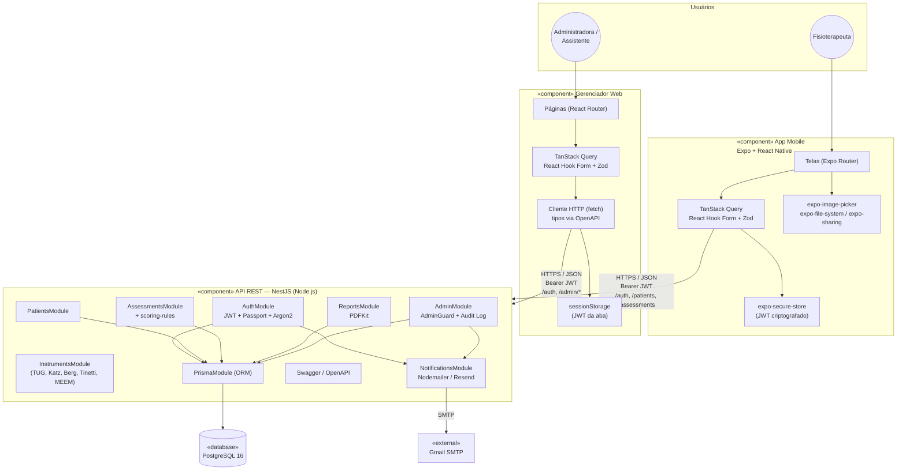
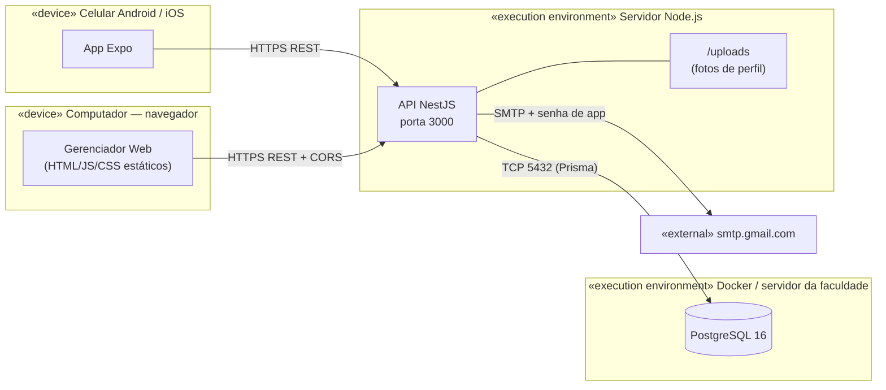
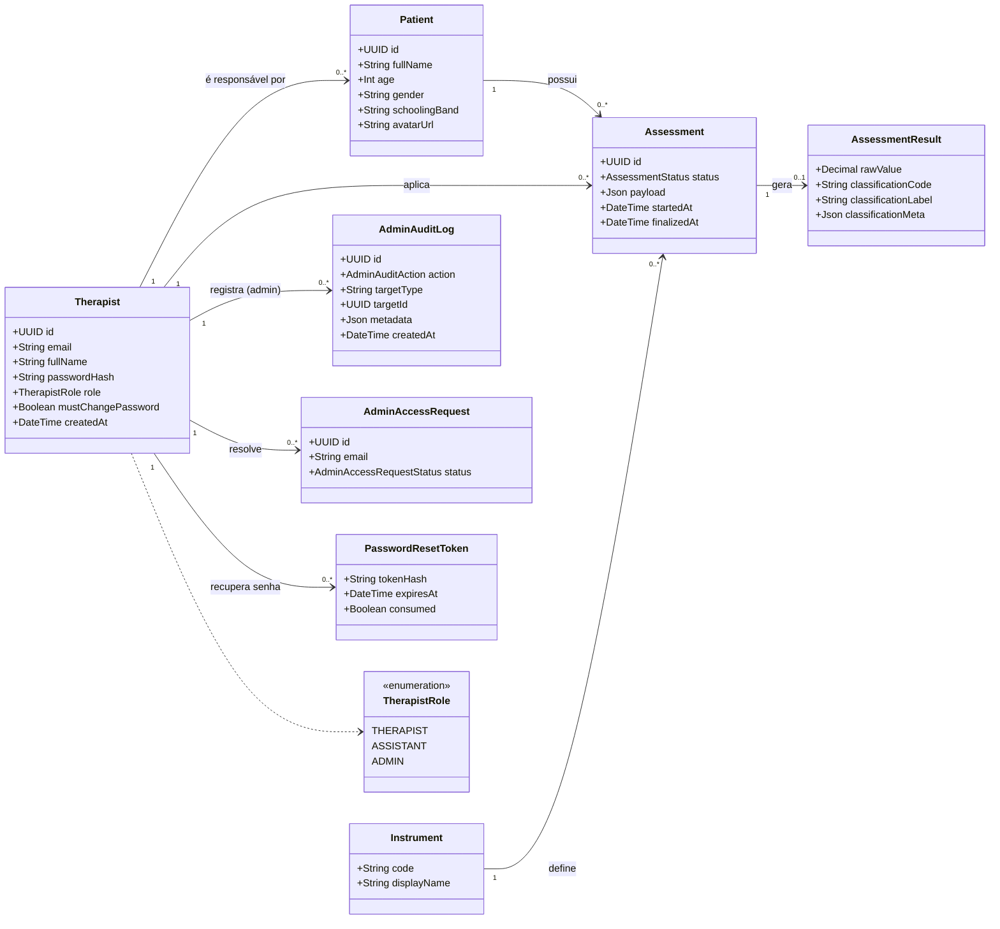
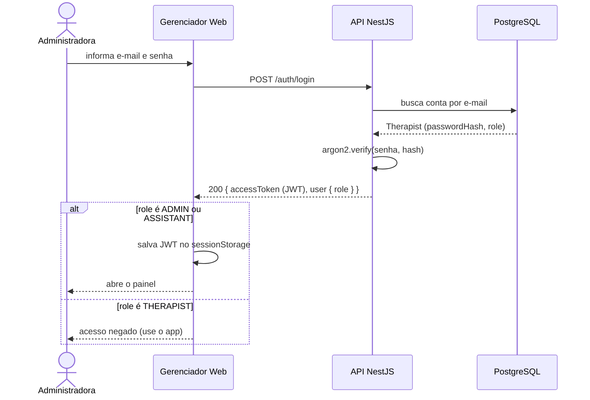
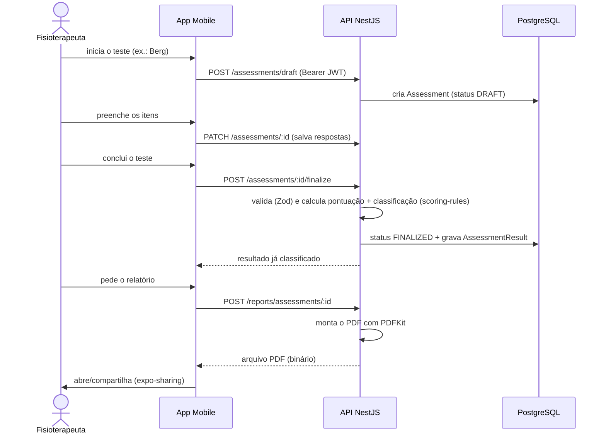

# Sênior Teste Funcional: stack, arquitetura e justificativas

Material de apoio para a apresentação do TCC. Cada seção tem duas versões:

- **Versão rápida**: para falar em poucos segundos durante a apresentação.
- **Versão técnica**: para responder perguntas da banca com detalhe.

---

## 1. Visão geral do sistema

### Versão rápida

O projeto tem **três partes que conversam entre si**:

1. **App mobile**: usado pelo fisioterapeuta no dia a dia para cadastrar pacientes idosos e aplicar os testes funcionais.
2. **Gerenciador web**: painel no navegador usado pela professora/administradora para supervisionar fisioterapeutas, pacientes e relatórios.
3. **API (servidor) + banco de dados**: o "cérebro" do sistema. Guarda os dados, calcula as notas dos testes, gera o PDF e envia e-mails.

O app e o painel **não calculam nada clínico**. Eles só mostram e coletam informação. Quem decide é a API, e isso garante que o resultado de um teste seja sempre o mesmo, venha de onde vier.

### Versão técnica

Arquitetura **cliente-servidor com API REST centralizada**: dois clientes (mobile e web) consomem uma única API NestJS, que é a única com acesso ao PostgreSQL. Regras de negócio (scoring dos instrumentos, classificação clínica, geração de PDF, autorização por papel) ficam **exclusivamente no servidor**, para evitar divergência entre clientes e reduzir a superfície de exposição de dados sensíveis de saúde (LGPD).

| Componente | Repositório | Usuário | Papel (role) |
|------------|-------------|---------|--------------|
| App mobile | `senior-test-funcional/frontend` | Fisioterapeuta | `THERAPIST` |
| Gerenciador web | `stf-gerenciador-web` | Administradora e assistentes | `ADMIN`, `ASSISTANT` |
| API REST | `senior-test-funcional/backend` | (serve os dois clientes) | — |
| Banco de dados | PostgreSQL (Docker em dev) | — | — |

---

## 2. Diagramas UML da arquitetura

### 2.1 Diagrama de componentes (visão do sistema como um todo)

### 2.2 Diagrama de implantação (onde cada parte roda)

- **Desenvolvimento**: PostgreSQL roda em container Docker (`docker-compose.yml`), API com `npm run start:dev`, gerenciador com `npm run dev` (porta 5173), app via Expo Go.
- **Produção (planejado)**: banco no servidor da faculdade; gerenciador publicado como build estático (`dist/`); app distribuído via EAS Build (Expo).

### 2.3 Diagrama de classes (modelo de domínio no banco)

> Os atributos foram simplificados para a apresentação. O esquema completo está em `senior-test-funcional/backend/prisma/schema.prisma`.

### 2.4 Diagrama de sequência — login no gerenciador web

### 2.5 Diagrama de sequência — aplicar teste e baixar o PDF

---

## 3. Stack do App Mobile

### Versão rápida

O app foi feito com **React Native usando Expo**, o que permite **um único código para Android e iPhone**. A linguagem é **TypeScript**, que evita muitos erros antes mesmo de rodar o app.

### Versão técnica

| Tecnologia | Para que serve no projeto | Por que foi escolhida |
|------------|---------------------------|------------------------|
| **React Native 0.86** | Renderizar as telas nativas | Um único código para Android e iOS; mesma base (React) usada no painel web, então o conhecimento é reaproveitado. |
| **Expo SDK 57** | Ferramental de build, câmera, arquivos, splash, fontes | Elimina a configuração nativa manual (Xcode/Android Studio); permite testar no celular real com Expo Go e gerar builds na nuvem com EAS. Ideal para uma equipe pequena. |
| **Expo Router** | Navegação baseada em arquivos (`app/(auth)`, `app/(main)`) | Rotas organizadas por pasta, separando claramente telas públicas (login) de telas autenticadas. |
| **TypeScript** | Linguagem | Tipagem estática reduz erros em dados clínicos (ex.: campos de um teste) e facilita manutenção. |
| **TanStack Query v5** | Buscar e cachear dados da API | Trata loading, erro, cache e atualização automática sem escrever esse código à mão. |
| **React Hook Form + Zod** | Formulários e validação | Formulários de testes clínicos são longos; RHF evita re-renderizações e Zod valida os dados com regras declarativas. Zod também é usado na API, o que mantém a validação coerente. |
| **expo-secure-store** | Guardar o token de login | Usa o Keychain (iOS) e o Keystore (Android): o token fica criptografado pelo sistema operacional, o que é importante com dados de saúde. |
| **expo-image-picker** | Foto de perfil | Acesso padronizado à câmera e galeria nos dois sistemas. |
| **expo-file-system + expo-sharing** | Salvar e compartilhar o PDF do relatório | Permite ao fisioterapeuta abrir ou enviar o relatório gerado pela API. |
| **react-native-reanimated, gesture-handler, svg** | Animações, gestos e gráficos | Bibliotecas padrão do ecossistema, com bom desempenho no celular. |
| **Vitest** | Testes unitários | Rápido e com a mesma sintaxe usada no gerenciador web. |

---

## 4. Stack do Gerenciador Web

### Versão rápida

O painel web é um site feito com **React e Vite**. Ele roda no navegador, só a administradora tem acesso, e todas as informações vêm da mesma API usada pelo app.

### Versão técnica

| Tecnologia | Para que serve no projeto | Por que foi escolhida |
|------------|---------------------------|------------------------|
| **Vite 7** | Servidor de desenvolvimento e build | Inicialização instantânea e build simples que gera arquivos estáticos (`dist/`). Fácil de hospedar em qualquer lugar. |
| **React 19 + TypeScript** | Interface | Mesma biblioteca do app mobile: a equipe usa uma única linguagem e um único modelo mental nos dois clientes. |
| **Por que não Next.js?** | — | O painel é privado, autenticado e não precisa de SEO nem de renderização no servidor. Uma SPA (aplicação de página única) com Vite é mais simples e suficiente. |
| **React Router 7** | Navegação entre telas (`/login`, `/dashboard`, `/patients/:id`…) | Padrão de mercado para SPAs React; permite proteger rotas por papel (`ADMIN`/`ASSISTANT`). |
| **TanStack Query v5** | Dados vindos da API | Mesmo padrão do mobile; cache em memória que é limpo no logout, o que atende à LGPD. |
| **React Hook Form + Zod** | Formulários (login, troca de senha, transferência de paciente) | Mesmo padrão do mobile. |
| **Tailwind CSS + CSS variables** | Estilização | Tokens de cor do app (`--stf-primary`, `--stf-error`…) centralizados; a identidade visual fica igual nos dois clientes. |
| **fetch nativo + openapi-typescript** | Cliente HTTP | Sem dependência extra; os tipos TypeScript são gerados automaticamente a partir do Swagger da API, então o front sempre "sabe" o formato exato das respostas. |
| **sessionStorage para o JWT** | Sessão de login | O token sobrevive ao F5, mas é apagado ao fechar o navegador. Em um computador compartilhado, isso reduz o risco de alguém acessar dados de pacientes depois. `localStorage` foi evitado de propósito. |
| **Gráfico de evolução próprio (SVG)** | Histórico dos testes do paciente | Componente SVG feito no projeto, sem biblioteca de gráficos: menos peso e controle total sobre cores e classificação clínica. |
| **Vitest + Testing Library** | Testes | Testa componentes do jeito que o usuário os usa (cliques, textos), não detalhes internos. |
| **Modo mock (`VITE_USE_MOCK_API`)** | Protótipo sem backend | Permitiu validar as telas com a orientadora antes de todos os endpoints existirem. |

---

## 5. Stack da API (backend) e banco de dados

### Versão rápida

O servidor foi feito com **NestJS** (Node.js) e guarda tudo em um banco **PostgreSQL**. Ele é o único que acessa o banco, calcula as notas dos testes, gera os PDFs e envia os e-mails.

### Versão técnica

| Tecnologia | Para que serve no projeto | Por que foi escolhida |
|------------|---------------------------|------------------------|
| **Node.js + NestJS 11** | Framework da API | Arquitetura modular (um módulo por domínio: Auth, Patients, Assessments, Reports, Admin), injeção de dependência e guards prontos. Usa TypeScript, então a equipe trabalha com a mesma linguagem do front ao back. |
| **PostgreSQL 16** | Banco de dados relacional | Dados com relações fortes (fisioterapeuta → paciente → avaliação → resultado) e integridade referencial. Tem suporte a JSON para o conteúdo das avaliações. Gratuito e amplamente usado. |
| **Prisma 6** | ORM / migrations | Esquema declarativo legível (`schema.prisma`), migrations versionadas e consultas tipadas: um erro de nome de campo aparece na compilação, não em produção. |
| **JWT + Passport (`@nestjs/jwt`, `passport-jwt`)** | Autenticação | Login sem estado no servidor (stateless), funciona igual para o app e para o navegador. |
| **Argon2id** | Hash das senhas | Algoritmo recomendado pela OWASP e vencedor da Password Hashing Competition; mais resistente a ataques com GPU do que o bcrypt. |
| **Guards por papel (`AdminGuard`)** | Autorização | Rotas `/admin/*` só respondem para `ADMIN`/`ASSISTANT`, mesmo que alguém tente acessar por fora do painel. A segurança não depende do front. |
| **Zod + `@nestjs/config`** | Validação de entrada e de variáveis de ambiente | A API não sobe se faltar uma variável obrigatória (ex.: segredo JWT). Os dados recebidos são validados antes de chegar ao banco. |
| **Swagger (`@nestjs/swagger`)** | Documentação da API em `/api/docs` | Contrato visível e testável; é dele que o gerenciador gera os tipos TypeScript automaticamente. |
| **PDFKit** | Geração do relatório clínico em PDF | Gera o PDF direto no Node, sem precisar de navegador headless (como Puppeteer). É mais leve e o layout fica padronizado no servidor. |
| **Audit log (`AdminAuditLog`)** | Rastreabilidade de ações administrativas | Registra exclusões, transferências e downloads de relatório, sem guardar dados clínicos no log. Atende ao princípio de responsabilização da LGPD. |
| **Jest + Supertest** | Testes unitários e end-to-end | Padrão do NestJS; os testes e2e usam um banco isolado para nunca apagar dados reais. |
| **Docker / Docker Compose** | Subir o PostgreSQL em desenvolvimento | Qualquer pessoa da equipe sobe o mesmo banco com um comando (`make setup`), sem instalar Postgres na máquina. |

### Instrumentos clínicos implementados (regras no servidor)

| Instrumento | Avalia |
|-------------|--------|
| **TUG** (Timed Up and Go) | Mobilidade e risco de quedas (tempo) |
| **Katz** | Independência nas atividades básicas de vida diária |
| **Berg** | Equilíbrio e risco de quedas |
| **Tinetti** | Marcha, equilíbrio e risco de quedas |
| **MEEM** (Mini-Exame do Estado Mental) | Cognição, com nota de corte por escolaridade (Brucki et al., 2003) |

Cada classificação carrega a **versão da regra de pontuação** usada (`versionTag`, ex.: `meem-brucki-2003`, definida em `scoring-rules`). Se a regra mudar no futuro, dá para saber qual critério gerou cada resultado antigo.

---

## 6. Serviços e tecnologias externas

### Versão rápida

O único serviço externo em uso é o **Gmail**, para enviar e-mails de recuperação de senha e de senha temporária. Optamos por não comprar domínio porque é um projeto acadêmico, e o sistema já está preparado para trocar de serviço de e-mail sem mexer nas telas.

### Versão técnica

| Serviço / lib externa | Uso | Justificativa no contexto do projeto |
|-----------------------|-----|--------------------------------------|
| **Gmail SMTP via Nodemailer** (ativo) | E-mail com código de 6 dígitos para recuperar senha e envio de senha temporária a novos admins/assistentes | Gratuito e sem necessidade de domínio próprio. Usa uma **conta dedicada ao projeto** com **senha de app** (exige verificação em duas etapas), nunca o e-mail pessoal. Decisão registrada em `senior-test-funcional/docs/engineering/project-decisions.md`. |
| **Resend** (alternativa já implementada) | Provedor transacional profissional | Exige domínio verificado e por isso ficou fora do escopo do TCC. Basta mudar `MAIL_PROVIDER=resend` para migrar quando houver domínio. |
| **Modo `console`** | E-mail impresso no terminal | Usado só em CI e testes offline. |
| **Expo / EAS** | Build e distribuição do app | Gera os instaladores Android e iOS na nuvem, sem precisar de um Mac para o iOS. |
| **Docker Hub (`postgres:16-alpine`)** | Imagem oficial do banco | Imagem oficial, leve e com versão fixa: todos usam o mesmo banco. |
| **sharp** (só em desenvolvimento) | Tratar a logo do CESMAC usada no PDF | Script executado uma vez para preparar a imagem; não roda em produção. |

**Ponto de projeto importante:** o envio de e-mail fica isolado em `NotificationsModule`. Trocar de provedor (Gmail → Resend → outro) muda **apenas** esse módulo e as variáveis `MAIL_*`. As telas e as rotas HTTP continuam iguais.

**O que não usamos, e por quê:**

| Alternativa | Motivo de não usar |
|-------------|--------------------|
| Firebase / Supabase Auth | Os dados de saúde ficariam em um terceiro. Com NestJS + PostgreSQL próprios, temos controle total dos dados (LGPD) e o banco pode ir para o servidor da faculdade. |
| Gerar PDF no celular/navegador | Cada cliente poderia gerar um relatório diferente. O PDF institucional é único e gerado no servidor. |
| Calcular notas no app | Mesmo motivo: uma única fonte da verdade para o resultado clínico. |

---

## 7. Segurança e LGPD (resumo para a banca)

### Versão rápida

O sistema lida com **dados de saúde de idosos**, que a LGPD classifica como dados sensíveis. Por isso: senhas com hash forte, login com token, cada usuário só vê o que o papel dele permite, ações perigosas pedem confirmação e ficam registradas em log.

### Versão técnica

| Medida | Onde |
|--------|------|
| Senhas com **Argon2id**; códigos de recuperação também guardados como hash | API |
| **JWT** com expiração; segredo validado na inicialização | API |
| Autorização por **papel** (`THERAPIST`, `ASSISTANT`, `ADMIN`) com guards no servidor | API |
| Token em **secure-store** (mobile) e **sessionStorage** (web), nunca em `localStorage` | Clientes |
| Logout limpa o token **e** o cache de dados em memória | Clientes |
| **Confirmação explícita** antes de excluir ou transferir pacientes | Gerenciador |
| **Audit log** append-only das ações administrativas, sem payload clínico | API + banco |
| Nada de token, senha ou dado clínico em logs | Todos |
| CORS restrito à origem do gerenciador em produção; HTTPS obrigatório | API |
| Troca de senha obrigatória no primeiro login de contas criadas pelo admin | API + Gerenciador |

---

## 8. Resumo de uma frase por camada (para fechar a apresentação)

| Camada | Frase |
|--------|-------|
| **Mobile** | Expo + React Native: um único código para Android e iOS, usado pelo fisioterapeuta em campo. |
| **Web** | Vite + React: painel leve e seguro para a administradora supervisionar tudo pelo navegador. |
| **API** | NestJS: o único lugar onde ficam as regras clínicas, a segurança e o PDF. |
| **Banco** | PostgreSQL + Prisma: dados relacionais íntegros, com histórico e regras de pontuação versionadas. |
| **Externo** | Gmail SMTP: e-mail gratuito e trocável, adequado ao escopo acadêmico. |
| **Escolha geral** | Uma só linguagem (TypeScript) de ponta a ponta, com ferramentas maduras de mercado que uma equipe pequena consegue manter. |
